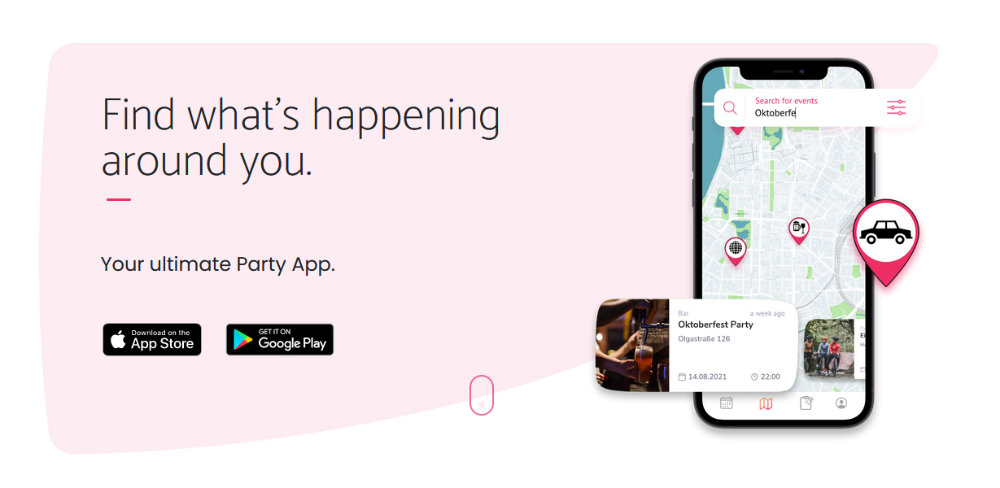
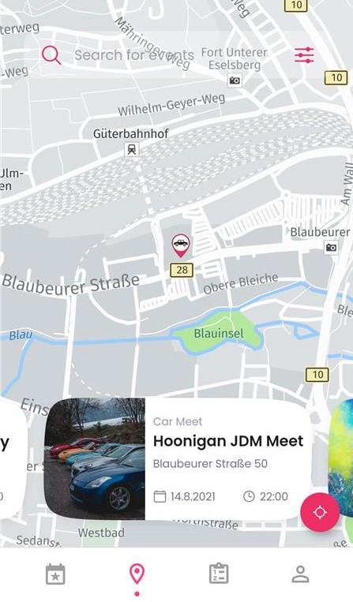
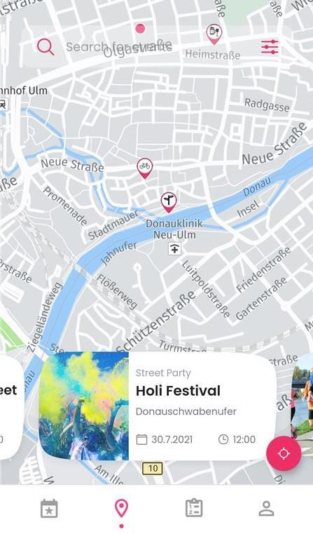
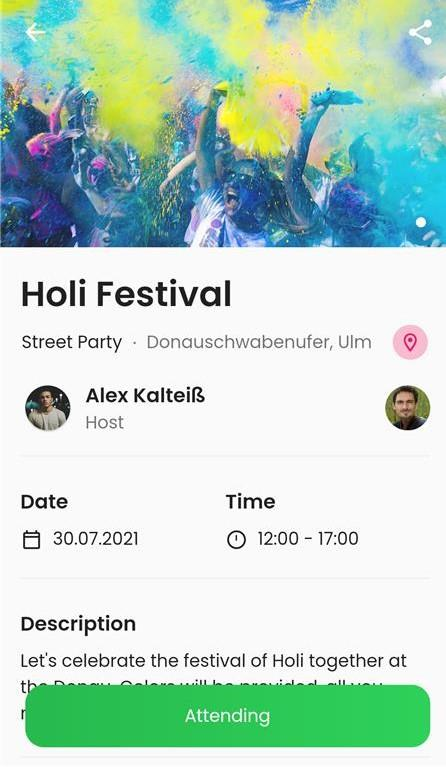
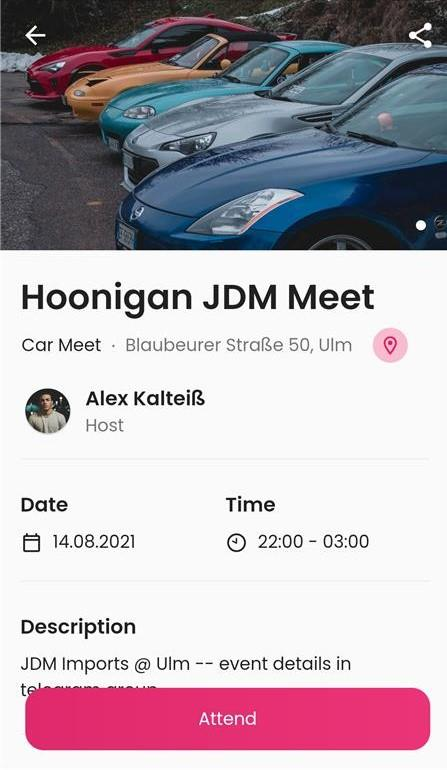

<p align="center">
  
</p>

# Hopaut Landing Page

**Hop out of your house!** Hopaut is a geosocial networking app for discovering, creating and joining events around you, from street parties and club nights to car meets, bike rides and sports events, all on one map.

This repository contains the **Hopaut website**: the landing page, the company and team pages, the legal pages and the account pages that go with the mobile app.

## What is Hopaut?

Meeting new people and finding something to do is harder than it should be, especially for international students, tourists and anyone new in town. Existing platforms tend to be built around tickets or closed groups, and their events are rarely shown on a map.

Hopaut takes a different approach:

- **Find events nearby.** The app uses your location to show what is happening around you. Browse the map, pick what you are in the mood for, and join with one tap.
- **Host your own.** Throwing a party, a meetup or a sports event? Post it in a couple of minutes and let others find it.
- **For businesses too.** Bars, clubs and event organizers can promote their events to the people nearby.
- **Niche, not generic.** Hopaut focuses on social and party events instead of trying to cover everything.

## Screenshots

<table>
  <tr>
    <td align="center"></td>
    <td align="center"></td>
    <td align="center"></td>
    <td align="center"></td>
  </tr>
  <tr>
    <td align="center"><sub>Events around you on the map</sub></td>
    <td align="center"><sub>Preview cards while you browse</sub></td>
    <td align="center"><sub>Event details and host</sub></td>
    <td align="center"><sub>Date, time and description</sub></td>
  </tr>
</table>

## What is in this repository

- **Landing page** that presents the app and links to its Google Play listing
- **About us** and **Team** pages
- **Register and login** screens, plus the landing pages for **e-mail confirmation** and **password reset**
- **Legal pages:** privacy policy, terms of service (GDPR) and imprint
- **English and German** versions of the site

The backend API that the account pages talk to is not part of this repository.

## Tech stack

- [React](https://reactjs.org/) 17, bootstrapped with [Create React App](https://github.com/facebook/create-react-app)
- [React Router](https://v5.reactrouter.com/) for navigation
- [i18next](https://www.i18next.com/) / react-i18next for the English and German translations
- [Bootstrap](https://getbootstrap.com/) 4, [styled-components](https://styled-components.com/) and [react-slick](https://react-slick.neostack.com/) for the UI
- [axios](https://axios-http.com/) for API calls and [react-markdown](https://github.com/remarkjs/react-markdown) to render the legal texts

## Getting started

You need [Node.js](https://nodejs.org/) and npm.

```bash
npm install
npm start        # development server at http://localhost:3000
```

Other scripts:

```bash
npm test         # run the tests in watch mode
npm run build    # production build in the build/ folder
```

## Links

- Website: [hopaut.com](https://hopaut.com/)
- Android app: [Hopaut on Google Play](https://play.google.com/store/apps/details?id=com.hopaut.hopaut)
- LinkedIn: [Hopaut UG](https://www.linkedin.com/company/hopaut-ug/)
